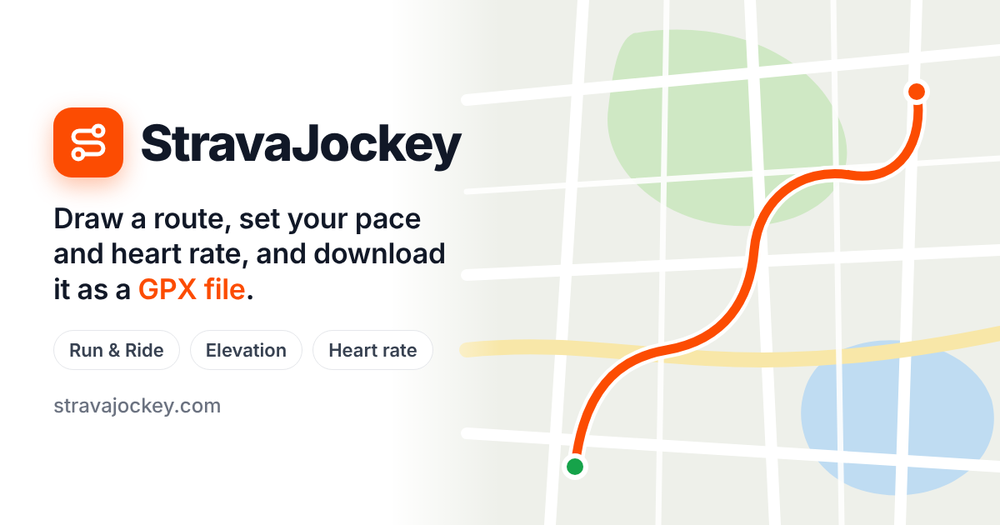

# StravaJockey

[](https://github.com/Markus-bit/StravaJockey/actions/workflows/ci.yml)
[](LICENSE)

Draw a route on a map, choose pace and heart rate settings, and download it as a GPX file.

**Live: [www.stravajockey.com](https://www.stravajockey.com)**



## What it does

- Click points on the map and **snap** them to roads and paths (Mapbox Directions; Run uses
  walking routes, Bike uses cycling routes).
- **Stats and charts**: distance, duration, elevation gain, and elevation / pace / heart rate along
  the route, with a shared hover marker on the map. Units: min/km, min/mi, km/h or mph
  (elevation in feet with miles).
- **Settings**: average pace, pace inconsistency, heart rate (average and variability), name,
  date and start time (no future times).
- **Download GPX**: track points every 25 m with timestamps, elevation and heart rate
  (Garmin TrackPointExtension). The charts and the file use the same random seed, so the file
  matches the preview.

## Tech stack

- **Frontend:** React 19, TypeScript, Vite, Mapbox GL JS, hand-drawn SVG charts, Lucide icons
- **API:** Node.js, Express 5, TypeScript, Zod validation, Helmet, express-rate-limit, Pino logging
- **Data:** Mapbox Directions / Map Matching (routing), Mapbox Terrain-RGB tiles (elevation),
  OpenTopoData (elevation fallback)
- **Quality:** Vitest (unit + API tests), ESLint, GitHub Actions CI, npm audit
- **Hosting:** Vercel (Services: CDN-served frontend + Express function), Vercel Firewall and Web Analytics,
  Upstash Redis (usage counters)

## Project structure

| Path | What |
|---|---|
| `src/` | Express + TypeScript API: routing (Mapbox), elevation (Mapbox terrain tiles, OpenTopoData fallback), pace/heart rate generation, GPX writer |
| `frontend/` | React + Vite app: map, Run Details panel, charts, help and terms dialogs. All styles are in `frontend/src/index.css`; the brand colour is `--brand` at the top |
| `tests/` | Vitest unit and API tests |
| `scripts/og-image.html` | Template for the link preview image |
| `vercel.json` | Vercel deployment (two services, security headers) |
| `.github/workflows/ci.yml` | CI: type-check, tests, lint, build, dependency audit |

## Setup

Requires Node.js 20 or newer.

```bash
npm install
npm --prefix frontend install
cp .env.example .env                    # then fill in MAPBOX_TOKEN
cp frontend/.env.example frontend/.env  # then fill in VITE_MAPBOX_TOKEN
```

## Development

```bash
npm run dev
```

Opens the API on http://localhost:4000 and the site on http://localhost:5173 (Vite forwards `/api` to the API).

**After every `git pull`**, run both installs again; new packages otherwise cause
"Cannot find module" / "Failed to resolve import" errors:

```bash
npm install
npm --prefix frontend install
```

## Checks

```bash
npm test          # unit and API tests (Vitest, tests/)
npm run check     # type-check + tests + frontend lint + frontend build (same as CI)
```

GitHub Actions (`.github/workflows/ci.yml`) runs the same checks plus a dependency audit on every
pull request and every push to `main`. Merge only when the check is green.

## Production

```bash
npm run build   # compiles the API to dist/ and the site to frontend/dist/
npm start       # serves the API and the built site on $PORT
```

`VITE_MAPBOX_TOKEN` is baked into the site at build time, so set it before `npm run build`.

On a hosting platform: build command `npm install && npm --prefix frontend install && npm run build`,
start command `npm start`, and set `MAPBOX_TOKEN`, `VITE_MAPBOX_TOKEN` and (behind the platform's proxy)
`TRUST_PROXY=1` as environment variables. Serve the site over HTTPS.

## Deploying to Vercel

`vercel.json` deploys the project as two [Vercel Services](https://vercel.com/docs/services) on one domain:

| Service | Folder | Public on | What it is |
|---|---|---|---|
| `app` | `.` (`src/server.ts`) | `/api/*` | Express API, runs as a Vercel Function |
| `frontend` | `frontend/` | everything else | Vite site, served from Vercel's CDN |

1. Import the repository in Vercel (branch with `vercel.json`). It detects both services from `vercel.json`.
2. Add environment variables (Production and Preview): `MAPBOX_TOKEN` (server token, no URL
   restrictions) and `VITE_MAPBOX_TOKEN` (public website token, restricted to your domain).
   `TRUST_PROXY` is set automatically on Vercel.
3. Deploy, then add your domain under Project → Domains, and add that domain to the URL
   restrictions of the website token in Mapbox.

Things that work differently on Vercel than on a single always-on server:

- The API runs as functions that start and stop on demand, so the in-memory rate limits and caches
  are per running instance. A Vercel Firewall rule is the hard backstop (see below).
- Security headers for the site come from `vercel.json` (the API still sets its own).
- The Hobby plan is for personal, non-commercial use.

### Current production setup

- **Domain** `stravajockey.com`, DNS at the domain provider (not Vercel DNS):
  `A @ → 216.198.79.1` and `CNAME www → <value shown in Vercel → Domains>`. The apex redirects (308) to `www`.
- **Mapbox**: the website token is URL-restricted to `https://www.stravajockey.com`,
  `https://stravajockey.com`, the `*.vercel.app` address and `localhost:5173`; the server token
  has no URL restrictions. Usage notifications are set for map loads, routing and raster tiles.
- **Vercel Firewall**: rate-limit rule "API rate limit": request path matches
  `^/api/(route|generate-gpx)$`, fixed window 600 s, 100 requests per IP, 429.
- **Vercel Web Analytics** is enabled (`<Analytics />` in `frontend/src/App.tsx`; cookieless, described
  in the Terms of Service).
- **Usage stats**: our own daily counters (visits, snaps, download clicks, downloads, errors,
  help dialogs) in Upstash Redis (Vercel Marketplace, free plan, connected to the project).
  View them at [`/api/stats`](https://www.stravajockey.com/api/stats) with the password in
  `STATS_PASSWORD`. Only event names and dates are stored. Code: `src/services/stats.ts`,
  `src/statsRoutes.ts`, `frontend/src/track.ts`.
- **Google Search Console**: domain property verified with a TXT record at the domain provider
  (keep that record).

## Link preview image

`frontend/public/og-image.png` (1200 × 630) is shown when the site's link is shared. It's rendered
from `scripts/og-image.html`; after changing the name, colour or text, regenerate it as described at
the top of that file. The meta tags in `frontend/index.html` point to `https://www.stravajockey.com`.

## Limits and protection

All configurable via environment variables, see `.env.example`:

- Rate limits per visitor: 60 route requests and 20 GPX downloads per 10 minutes, 120 chart
  previews per minute, 600 API requests in total per 10 minutes.
- Routes: at most 200 clicked points and 300 km.
- Security headers (Content-Security-Policy etc.) via helmet; request bodies limited to 100 kB.
- Errors are returned as `{ "error": "<message for the user>" }`; details only go to the server log.

## License

[MIT](LICENSE). "Strava" is a trademark of Strava, Inc.; this project is independent and not
affiliated with or endorsed by Strava.
